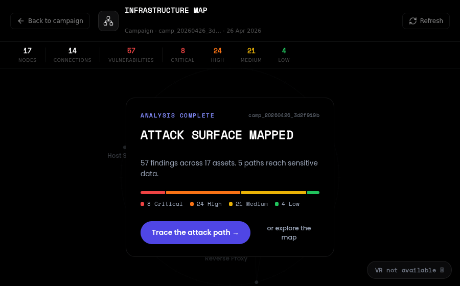

# Spatial Attack-Surface Visualization — Research Notes

> A research write-up on rendering an autonomous-pentest infrastructure map as a
> **navigable, WebXR-capable attack-surface** that a non-specialist can read in
> seconds and an analyst can reason with in three dimensions.
>
> This repository contains **documentation only** — no product source code.

*(The GIF above shows the guided walkthrough: an "attack surface mapped" briefing,
a MITRE ATT&CK attack-path narrative traced across the graph, and per-asset
vulnerability drill-down. It is a screen capture of the running feature.)*

---

## Abstract

Security tooling produces findings faster than humans can situate them. The
canonical artifact — a node-link "infrastructure graph" annotated with
vulnerabilities — routinely fails its readers: findings appear scattered or
collapse onto a single node, attack paths are implicit rather than shown, and
the whole is legible only to the expert who already knows the answer. We describe
an alternative: a deterministic pipeline that attaches every finding to the
**most specific asset it concerns**, reconstructs **attack paths** from the real
connectivity graph and MITRE ATT&CK tactic ordering, and renders the result as an
**orbital exposure map** with a **progressive-disclosure guided narrative**. The
same 2-D scene runs in a headset through **WebXR with no vendor SDK**, delivered
as an ordinary web page. We document the problem, the design rationale, the
iterations that produced the current form, the accessibility model, and an
evaluation plan. We make no empirical claims we have not measured.

## How to read this repository

| File | What it contains |
|---|---|
| [`PAPER.md`](PAPER.md) | The full write-up: problem, approach, iterations, HCI/accessibility reasoning, VR rationale, evaluation plan, vision. |
| [`docs/figures.md`](docs/figures.md) | Diagrams (pipeline, exposure rings, attack-path reconstruction) as inline SVG / Mermaid. |
| [`assets/`](assets/) | The demo GIF and any static media. |
| [`LICENSE`](LICENSE) | CC BY 4.0 — these documents may be reused with attribution. |

## Scope and honesty

- **No source code.** The Angular/three.js implementation is deliberately not
  included; this repository is about the *reasoning*, not the build.
- **No fabricated results.** Where we state a benchmark or a citation would go,
  we say so explicitly rather than inventing one. The evaluation section is a
  *plan*, not a report of measured outcomes.
- The visualization only ever maps findings onto assets that were actually
  discovered; it never invents infrastructure to make a picture look complete.

## Citation

If you reference this work, cite it as documentation (see `LICENSE`). A suggested
short form is provided at the end of `PAPER.md`.
