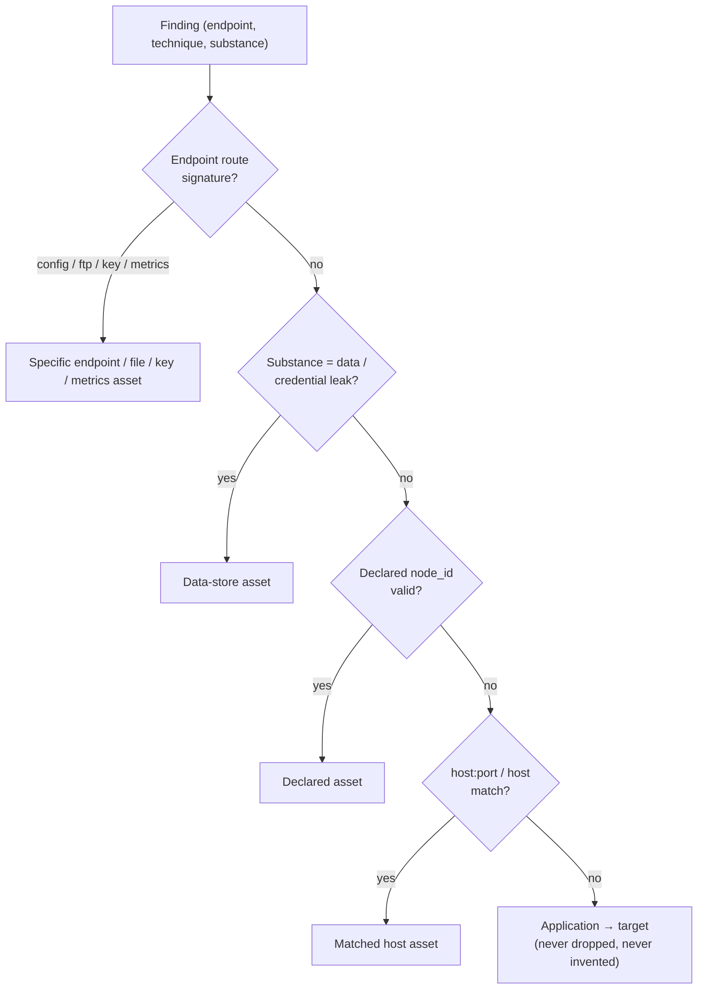
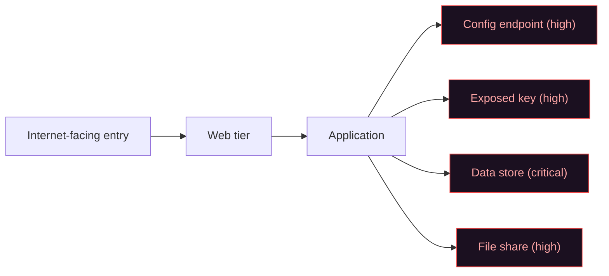

# Figures

Diagrams for the write-up. Rendered with Mermaid where GitHub supports it; the
exposure-ring figure is inline SVG so it renders anywhere.

## Figure 1 — Deterministic finding → asset attachment

The resolution order that binds each finding to the most specific asset it
concerns. Evaluated top to bottom; the first match wins. Nothing is fabricated.

## Figure 2 — Attack-path reconstruction

From the internet-facing entry node, a shortest path (BFS over real edges) to
each high/critical asset; the union of paths, ordered by the ATT&CK kill chain,
is what the map draws.

*Kill-chain ordering:* Reconnaissance → Initial Access → Execution → Privilege
Escalation → Credential Access → Discovery → Collection → Impact. Findings carry
technique references that place them in this order; the traversal is drawn along
it.

## Figure 3 — Orbital exposure rings (inline SVG)

Assets placed by exposure zone. Ring *position* encodes exposure preattentively;
severity is triple-encoded (color + size + glyph) on each asset.

<figure>
<svg viewBox="0 0 420 420" width="420" height="420" role="img" aria-label="Three concentric exposure rings — inner data and secrets, middle applications and services, outer internet-facing — with assets placed on each and an attack path crossing from the outer ring inward." xmlns="http://www.w3.org/2000/svg">
  <rect x="0" y="0" width="420" height="420" fill="#000"/>
  <circle cx="210" cy="210" r="180" fill="none" stroke="#5a6a86" stroke-opacity="0.35"/>
  <circle cx="210" cy="210" r="120" fill="none" stroke="#5a6a86" stroke-opacity="0.35"/>
  <circle cx="210" cy="210" r="60"  fill="none" stroke="#5a6a86" stroke-opacity="0.35"/>
  <text x="210" y="24"  fill="#6b7280" font-family="monospace" font-size="10" text-anchor="middle">INTERNET-FACING</text>
  <text x="210" y="102" fill="#6b7280" font-family="monospace" font-size="10" text-anchor="middle">APPLICATIONS &amp; SERVICES</text>
  <text x="210" y="162" fill="#6b7280" font-family="monospace" font-size="10" text-anchor="middle">DATA &amp; SECRETS</text>
  <!-- attack path -->
  <polyline points="210,30 210,90 210,150 150,300" fill="none" stroke="#ef4444" stroke-width="2" stroke-opacity="0.9"/>
  <!-- outer: entry -->
  <circle cx="210" cy="30" r="7" fill="#8792a6"/>
  <!-- middle: application (critical) -->
  <circle cx="210" cy="150" r="9" fill="#8792a6"/>
  <circle cx="210" cy="150" r="14" fill="none" stroke="#ef4444" stroke-width="2"/>
  <text x="228" y="146" fill="#fff" font-family="monospace" font-size="10">!</text>
  <!-- inner: data store (critical) -->
  <circle cx="150" cy="300" r="8" fill="#8792a6"/>
  <circle cx="150" cy="300" r="12" fill="none" stroke="#ef4444" stroke-width="2"/>
  <!-- middle: exposed key (high) -->
  <circle cx="300" cy="150" r="7" fill="#8792a6"/>
  <circle cx="300" cy="150" r="10" fill="none" stroke="#f97316" stroke-width="2"/>
  <!-- outer: healthy asset -->
  <circle cx="330" cy="90" r="6" fill="#8792a6" fill-opacity="0.6"/>
</svg>
<figcaption>Exposure by ring; severity by color + size + glyph; the red polyline is one reconstructed attack path from the internet-facing entry to a critical inner asset.</figcaption>
</figure>

## Figure 4 — Progressive disclosure

Three levels of the same scene, no mode switch imposed.

